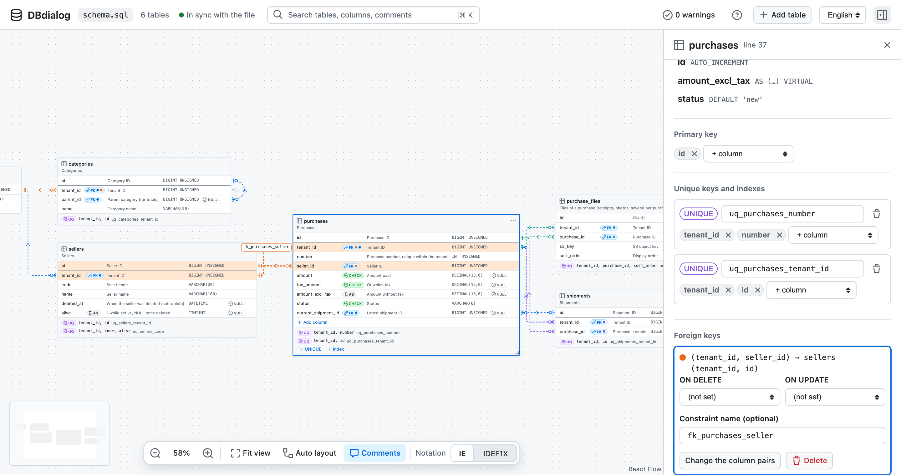
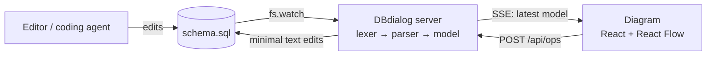

# DBdialog

[](https://github.com/ukirose/dbdialog/actions/workflows/ci.yml)
[](https://www.npmjs.com/package/@ukirose/dbdialog)
[](LICENSE)

Design a MySQL schema in dialogue with your coding agent.

You and the agent edit one `schema.sql`. The agent writes and reworks the DDL; you read it as a live ER diagram and adjust it there. Each side sees the other's edits at once.

The SQL file stays the source of truth. Edit it in your editor, or let a coding agent (Claude Code, Codex, …) edit it, and the diagram follows at once. Edit the diagram, and DBdialog rewrites only the part you changed: the rest of the file, your `--` comments, alignment and statement order stay byte for byte.



```sh
npx @ukirose/dbdialog schema.sql
```

## Status and requirements

DBdialog 0.1.0 is an early release. What it reads and writes is tested against MySQL 8.0 (see [Testing](#testing)), but its HTTP API and the layout file may still change.

- Node.js 22 or later
- MySQL 8.0 DDL; other databases are not supported
- For `dbdialog snapshot` only: Chrome, Chromium or Microsoft Edge

`npx @ukirose/dbdialog` runs it without installing. To keep one version for a project (and for the agent working in it), add it to the project; the command it installs is `dbdialog`:

```sh
npm install --save-dev @ukirose/dbdialog
npx dbdialog schema.sql
```

The commands below are written for a project that has it installed. Without installing, replace `npx dbdialog` with `npx @ukirose/dbdialog`.

## Why another ER tool

Most ER editors keep their own model (JSON, a project file) and treat SQL as something to import and export. Every export rewrites the file, and whatever the model has no place for is lost. That is a problem for schemas that rely on MySQL's own integrity features:

| Tool            | Source of truth         | What gets in the way                                                         |
| --------------- | ----------------------- | ---------------------------------------------------------------------------- |
| ERD Editor      | `.erd.json`             | SQL is import/export only; CHECK and generated columns are dropped on import |
| drawDB          | JSON in the browser     | SQL is import/export only (composite foreign keys arrived in 2026-06)        |
| MySQL Workbench | its `.mwb` model        | CHECK has no place at the table level in the model                           |
| sqldef          | SQL vs. a live database | No diagram; "composite foreign key may not work"                             |
| sqlER (VS Code) | `.sqler` + SQL          | SQLite only                                                                  |

DBdialog takes the other road:

1. **The SQL file is the model.** An agent needs no MCP server or plugin: it edits `schema.sql` like any other file, and the diagram updates.
2. **MySQL integrity features survive.** Composite primary and foreign keys, `CHECK`, generated columns, `DEFAULT` expressions and comments are read, drawn and edited, never dropped.
3. **Minimal rewrites.** A diagram edit becomes the smallest text change, so `git diff` shows exactly what was edited.

## Usage

```sh
npx dbdialog path/to/schema.sql [--port 4321] [--host 127.0.0.1] [--open] [--lang en|ja|auto]
```

Open the printed URL (`http://127.0.0.1:4321/`). The page speaks English by default; `--lang ja` starts it in Japanese, `--lang auto` follows the browser, and the language menu in the toolbar switches it (remembered per browser). In the Claude desktop app you can open it in the built-in browser and keep it next to the conversation.

What you want to see at a glance lives on the boxes and is edited there; what you need only now and then is in the sidebar.

- **Edit in place.** Double-click a table's name or comment, or a column's name, type or comment. Enter writes it, Esc cancels, Tab goes to the next cell. The "…" of a row (or a right-click) switches NULL, the primary key, UNIQUE and `AUTO_INCREMENT`, and inserts or deletes columns. A selected box shows _Add column_ (Enter adds one after another) and _+ UNIQUE_ / _+ Index_ (click the columns in order, then Enter).
- **Add a table** from the top bar: a new box appears on the diagram. Type its name and as many columns as you like; _Create_ (⌘Enter) writes one `CREATE TABLE`.
- **Draw a line** from the dot beside a column to the column it references: the foreign key is written at once. The side whose column makes up a whole key is the one referenced, whichever way you drew; a key of several columns is completed from columns of the same names (`purchases.seller_id` onto `sellers.id` gives `(tenant_id, seller_id) → sellers (tenant_id, id)`). The notice that follows has _Undo_; hold Alt while dropping to use one column only.
- **Click a table, a row or a line** to see in the sidebar what the box does not show: `DEFAULT`, `AUTO_INCREMENT` and generated expressions, constraint names, `ON DELETE` / `ON UPDATE`, `CHECK` expressions, warnings, and the table's SQL in color. Choosing a row also lights up every line that carries that column's values, through every table (a tenant ID, for example), and the sidebar shows where the values come from: `tenants.id ← sellers.tenant_id ← purchases.tenant_id`. With nothing selected, the sidebar lists the warnings; each one takes you to its place. Drag the sidebar's left edge to widen it, or close it with its button.
- **Auto layout** (the bar at the bottom) puts referenced tables to the left, orders the boxes so fewer lines cross, and routes every line at right angles around the boxes, never behind them. A foreign key that closes a cycle (two tables referencing each other) runs between its two boxes instead of around the diagram. It uses ELK (the Eclipse Layout Kernel), loaded only when a layout is computed. A schema opened without a saved layout gets it once.
- **Move boxes, and widen them** with the grip at their bottom-right corner. Positions, widths, the routed lines and the notation are saved in `schema.sql.layout.json` next to the schema, so this never touches `schema.sql`. A line keeps its route while both of its boxes stay where the layout put them; move a box by hand and its lines go back to plain right angles until the next auto layout.
- **Edit the file** (or have an agent do it). The diagram follows as soon as the file is saved. A table renamed in the file keeps its box position.

**Reading the diagram.** A box shows its primary key columns first, in key order, above a line, and the other columns under it (UNIQUE ones too), as IE and IDEF1X draw an entity; a table without a primary key says so above the line. The cells line up in columns: name, marks, comment, type, NULL. _Notation_ in the bottom bar draws the relationships in IE or IDEF1X:

- In both, a solid line is an identifying relationship (the foreign key is part of the child's primary key) and a dashed one a non-identifying relationship; rounded corners mark a dependent entity, the child of an identifying relationship. A dotted line is a `REFERENCES` inside a column, which MySQL ignores.
- **IE**: crow's feet (`||` exactly one, `o|` zero or one, `o<` zero or more). Marks are icons with their text: **FK** foreign key, **UQ** unique, **AS** generated column, **CHECK** a column a `CHECK` constraint uses (point at it to read the expression), **NULL** NULL allowed. The solid and dashed lines and the rounded corners come from IDEF1X, as erwin draws IE.
- **IDEF1X**, as in FIPS PUB 184: a dot at the child end, with **Z** beside it when the child has one row at most, and a diamond at the parent end when the foreign key can be NULL. Columns carry the standard's notes: **(FK)**, **(AK1)** for an alternate (UNIQUE) key, **(O)** for NULL allowed. The table name stays inside the box, with its menu.
- Everything is read from the DDL, so only what it enforces is drawn: a foreign key cannot require a child row, so "one or more" never appears.

Each foreign key has its own color, and the dots on its FK marks show it; a composite key draws one line per column pair, each from its own column's row (a column paired with itself in a key to its own table, like `tenant_id → tenant_id`, is a small loop beside its row). The arrow halfway along points from the referencing table to the referenced one. Keys of several columns and indexes are listed under the columns. Point at a table or a line to fade everything unrelated and see the line's label (constraint name, `ON DELETE`) above the boxes; point at a cut comment to read all of it. ⌘K / Ctrl+K searches tables, columns and comments, and the "?" in the top bar explains the marks of the notation in use. The page is built on Primer, GitHub's design system, and follows your OS's light or dark setting.

When the diagram and the file disagree (say an agent renamed a column while you were editing its comment), DBdialog refuses the edit with a _conflict_ and shows the latest file, instead of overwriting either side.

## Working with a coding agent

DBdialog has no agent of its own and needs no MCP server: the agent edits `schema.sql` like any other file, and you watch and adjust the result in the diagram. Two commands give the agent the same checks the diagram shows:

```sh
npx dbdialog lint schema.sql          # file:line:column, severity, rule, message; exit code 1 on errors or warnings
npx dbdialog lint schema.sql --json   # the same, as JSON
npx dbdialog mermaid schema.sql       # a Mermaid erDiagram, with cardinality read from the DDL
```

A line like this in `CLAUDE.md` or `AGENTS.md` closes the loop:

```text
After editing schema.sql, run `npx dbdialog lint schema.sql` and fix every error and warning it reports.
```

### Letting the agent look at the structure

The SQL tells an agent each column, type and constraint where it is written, but not at a glance how the tables hang together, or where that pattern breaks. `dbdialog snapshot` draws just that, as a picture for the agent's image input:

```sh
npx dbdialog snapshot schema.sql -o er.png                     # the graph of the tables, as a PNG
npx dbdialog snapshot schema.sql -o er.png --focus purchases   # one table and the tables next to it
```

Every table is a box with its primary key, and with how many foreign keys it has and how many reference it. Every foreign key is a line from the child to the parent: the arrowhead is at the parent, and the line is solid when the relationship is identifying and dashed when not. Parents stand left of their children. What breaks the pattern is drawn too, since a picture shows an exception at once where a file of statements hides it: a line that needs a look is red, with the reason on it (it closes a cycle, or it leaves out the column most foreign keys carry, such as a `tenant_id`), and a column named like a reference that no foreign key uses (`customer_id`, `commentable_id`) runs to a "?". Types, NULL and the contents of constraints are left out; the agent reads them from the SQL. A header says how to read the picture and counts what it shows, and the command prints the same as text.

`dbdialog lint` reports the same signs, among others of the SQL antipatterns the DDL alone can show (Bill Karwin, _SQL Antipatterns_): a column named like a reference with no foreign key (Keyless Entry, Polymorphic Associations), a foreign key that lets a row point into another tenant, money in FLOAT or DOUBLE (Rounding Errors), and numbered columns such as `tag1, tag2` (Multicolumn Attributes). The ones read from names alone are notes, which do not fail the command.

The picture is sized for the image input of current models: at most 2000 × 1250 pixels, cut to what it holds, with no text under 12 px unless the header says so. For a schema too large for that, `--focus` draws a part. While the diagram runs, the same view is at `/?view=agent` (with `&focus=` and `&lang=`); it only reads. The command needs Chrome, Chromium or Edge (or `CHROME_PATH`); it runs it headless on a pipe and opens no other port.

### Telling the agent what you selected

With Claude Code, what you select on the diagram (a table, a column, or a line's foreign key) can go to the agent with your next message, the way an editor shares selected lines. Add a `UserPromptSubmit` hook to the project's `.claude/settings.json`:

```json
{
  "hooks": {
    "UserPromptSubmit": [
      {
        "hooks": [
          { "type": "command", "command": "npx dbdialog hook", "timeout": 5 }
        ]
      }
    ]
  }
}
```

Before each message, `dbdialog hook` asks the running DBdialog servers whose schema is inside the session's folder what is selected, and Claude Code adds it to the message:

````text
Selected in DBdialog: db/schema.sql line 45 (column status of table purchases)
```sql
  status              VARCHAR(6)      NOT NULL DEFAULT 'new' COMMENT 'Status',
```
````

A selection goes to each session once; after that, only a new one does. Running servers announce themselves in `~/.dbdialog/servers/` so the hook can find them.

## What round-trips

DBdialog keeps all of the following intact through every edit, and lets you edit it from the diagram unless noted. It is tested against MySQL 8.0 (see [Testing](#testing)).

- Composite primary keys, composite foreign keys such as `FOREIGN KEY (tenant_id, seller_id) REFERENCES sellers (tenant_id, id)`, multi-column `UNIQUE` keys and indexes (functional key parts are kept as written)
- `CHECK` constraints at table and column level, named or not, `NOT ENFORCED`
- Generated columns: `AS (…) STORED` / `VIRTUAL`, `GENERATED ALWAYS AS`
- `DEFAULT` literals and expressions, `ON UPDATE CURRENT_TIMESTAMP`, `AUTO_INCREMENT`
- Table and column `COMMENT`s in any language, names in any language (MySQL allows `作品` without quotes), backtick-quoted names
- Self-referencing foreign keys and tables that reference each other
- `ON DELETE` / `ON UPDATE` actions and constraint names; table options (`ENGINE=…`, `DEFAULT CHARSET=…`) are kept as written, and new tables reuse them
- Comments (`--`, `#`, `/* */`), `DELIMITER` blocks and every statement that is not `CREATE TABLE` are kept as written

DBdialog reports foreign keys that MySQL 8.0 would refuse, before you run the file. Each rule was taken from MySQL 8.0.46 itself, and `npm run verify:mysql` checks that MySQL refuses exactly the cases DBdialog reports:

- Column types that do not match: integers of different sizes or signs, different character sets or collations (including table defaults), DATE vs DATETIME, strings vs binary strings (error 3780). DECIMAL precision, string length, CHAR vs VARCHAR and DATETIME vs TIMESTAMP may differ, and are not reported
- VIRTUAL generated columns in a foreign key, on either side (error 3733)
- A STORED generated column with `ON DELETE SET NULL` or `ON UPDATE CASCADE` (error 3104), and a column a STORED generated column is computed from with `CASCADE` or `SET NULL` (error 1215)
- TEXT, BLOB and JSON columns in a foreign key

It also warns about things MySQL 8.0 accepts silently:

- `REFERENCES` written inside a column definition. MySQL 8.0 parses it and creates no foreign key. Write it as a table-level `FOREIGN KEY (…) REFERENCES …`; the panel can convert it.
- Foreign keys to tables or columns that do not exist, and column counts that do not match
- Names containing a full-width space (U+3000), which MySQL reads as part of the name
- Duplicate tables and columns, and `CREATE TABLE` text it cannot read (kept as is)

## How it works



- A **lossless lexer** turns the file into tokens that cover every character, whitespace and comments included. A hand-written **parser** for MySQL's `CREATE TABLE` builds a model in which every part (a column's type, its `NOT NULL`, a comment literal, a key's column list) remembers its span in the file. Expressions are kept as the text between their parentheses.
- An edit from the diagram is an **operation** ("set the comment of `purchases.status`"), applied to the latest file on disk: DBdialog finds the part, computes the smallest text edits and copies the file's style for new text (keyword case, indentation, aligned columns, `UNIQUE KEY` vs `UNIQUE`). The diagram sends the values it showed; if the file changed since, the edit is refused as a conflict.
- The result is parsed again before it is written; an edit that would make the file unreadable is refused.
- The server uses only Node.js built-ins (`http`, `fs.watch`, Server-Sent Events). It listens on `127.0.0.1`, checks the `Host` header, and accepts edits only with an `X-Dbdialog` header that other web pages cannot send. There is no authentication: `--host` with another address lets anyone who can reach it edit the file.

Any client can use the same API:

```sh
curl -X POST http://127.0.0.1:4321/api/ops -H 'Content-Type: application/json' -H 'X-Dbdialog: 1' \
  -d '{"ops":[{"op":"column.update","table":"purchases","column":"status","set":{"comment":"Where the purchase stands"}}]}'
```

## Limitations

- Only `CREATE TABLE` is drawn. `ALTER TABLE` and `CREATE INDEX` are kept in the file and listed in the overview, not drawn.
- One schema file per server.
- Renaming a column updates its uses in keys, foreign keys (in every table) and in `CHECK`, generated and `DEFAULT` expressions of its table; it does not look into triggers or views.
- Double quotes are read as strings (MySQL's default `sql_mode`; `ANSI_QUOTES` is not supported).

## Development

Requires Node.js 22 or later (development uses Node 24).

```sh
npm install
npm run dev -- path/to/schema.sql   # server with Vite hot reload
npm run lint                        # Biome
npm run typecheck
npm test                            # unit and server tests (Vitest)
npm run test:e2e                    # browser tests with your installed Chrome (Playwright)
npm run verify:mysql                # runs the fixtures in MySQL 8.0 (needs Docker)
npm run build
```

### Testing

- `test/ops.test.ts` checks that edits change nothing but their target: whole-file comparisons for common edits, a dozen edit/undo pairs that must restore the original byte for byte, and a session of edits after which every untouched `CREATE TABLE` is identical.
- `test/fixtures/fk-cases.ts` holds 27 foreign keys with the error MySQL 8.0.46 gives for each (or none). The unit tests check DBdialog's reports against it; `npm run verify:mysql` replays every case in a real MySQL.
- `npm run verify:mysql` also runs three fixtures (a library, a marketplace, and one in Japanese), before and after a series of diagram edits, in `mysql:8.0`, then compares MySQL's catalog with DBdialog's model: every comment (Japanese included), the number of `CHECK` constraints, generated column storage, and each foreign key's columns and `ON DELETE` rule. It also confirms that MySQL 8.0 really ignores an inline `REFERENCES`.

## License

MIT. The page bundles third-party software under its own licenses, among them elkjs under the EPL-2.0; see [THIRD-PARTY-NOTICES.md](THIRD-PARTY-NOTICES.md).
